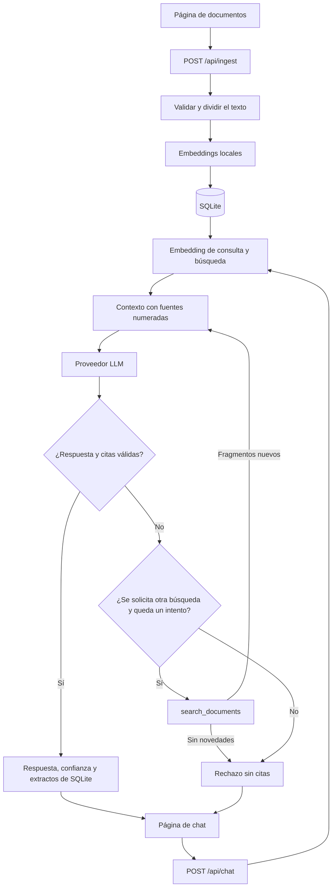

# Arquitectura

El navegador conserva la conversación y llama a las rutas de Next.js. El servidor Node.js tiene acceso a SQLite, los embeddings locales y el proveedor configurado. Una subida prepara el índice para búsquedas posteriores. Cada pregunta vuelve a consultar ese índice.

### Escritura del índice

La ruta de ingesta recibe el cuerpo del archivo y su nombre en la cabecera `x-filename`. Comprueba extensión, tipo declarado, tamaño durante la lectura, codificación UTF-8 y presencia de texto legible. Sanea el nombre y calcula SHA-256 del contenido para detectar duplicados. Divide el texto en ventanas de 80 unidades con 16 de solapamiento. Cada unidad admite hasta 64 caracteres consecutivos sin espacios. Los fragmentos conservan el espaciado original para poder mostrarlo en las citas. [Validación](../src/lib/rag/upload.ts) · [Troceado](../src/lib/rag/chunking.ts)

Transformers.js carga MiniLM multilingüe cuantizado y procesa lotes de hasta ocho fragmentos en CPU. Aplica agrupación por media y normalización para obtener vectores de 384 dimensiones. Una transacción guarda el documento, su texto y el hash en `documents`, junto con la posición, el texto y el vector JSON de cada fragmento en `chunks`. La clave foránea propaga el borrado. El fichero persistente es `data/rag.sqlite`. [Embeddings](../src/lib/rag/embeddings.ts) · [Esquema](../src/lib/db.ts) · [Transacción](../src/lib/rag/vector-store.ts)

### Lectura del índice

1. La ruta valida el historial y admite preguntas de hasta 4000 caracteres. El navegador puede enviar hasta diez turnos previos. Si la pregunta tiene seis palabras o menos, el buscador incorpora la pregunta anterior para resolver referencias breves.
2. El servidor calcula el embedding de la consulta, recorre los fragmentos y descarta los que tienen similitud coseno inferior a 0,35. Ordena los candidatos restantes sumando hasta 0,5 puntos por coincidencias de palabras de la consulta, con más peso para las poco frecuentes. Recupera como máximo cuatro por búsqueda. [Recuperación](../src/lib/rag/retrieve.ts)
3. El modelo recibe la pregunta, el historial y un bloque JSON con identificadores de fuente válidos para esa respuesta. El mensaje de sistema trata nombres y extractos como datos no fiables e indica que el historial solo sirve para interpretar referencias. [Plantillas](../src/lib/rag/prompts.ts)
4. El adaptador valida la salida con Zod. El servidor exige una respuesta con texto, al menos una cita y referencias dentro del conjunto recuperado. Si la búsqueda inicial no aporta fragmentos o la respuesta carece de referencias utilizables, el modelo puede pedir una consulta reformulada. Solo se ejecuta una llamada adicional a la herramienta y solo se vuelve a generar si aporta fragmentos nuevos. Una biblioteca vacía produce un aviso de indexación. Un fallo técnico del proveedor se comunica como error. [Coordinación](../src/lib/rag/answer.ts) · [Contratos](../src/lib/llm/contracts.ts)
5. La ruta devuelve eventos NDJSON con progreso, texto validado, citas y confianza. El navegador muestra el resultado completo tras la validación. Al desplegar una fuente, muestra el extracto guardado. La correspondencia entre identificador y extracto se verifica por código. Comprobar que ese extracto respalda cada afirmación requiere evaluar el contenido. [Ruta de chat](../src/app/api/chat/route.ts) · [Interfaz](../src/components/chat.tsx)

La ruta aplica un límite en memoria de diez peticiones por minuto. En local comparte el cupo entre peticiones. Activa `TRUST_PROXY=true` únicamente detrás de un proxy que sobrescriba `X-Real-IP` y sea la única entrada al servidor. La ruta combina cancelación del cliente y un plazo de 180 segundos para las llamadas al proveedor.
