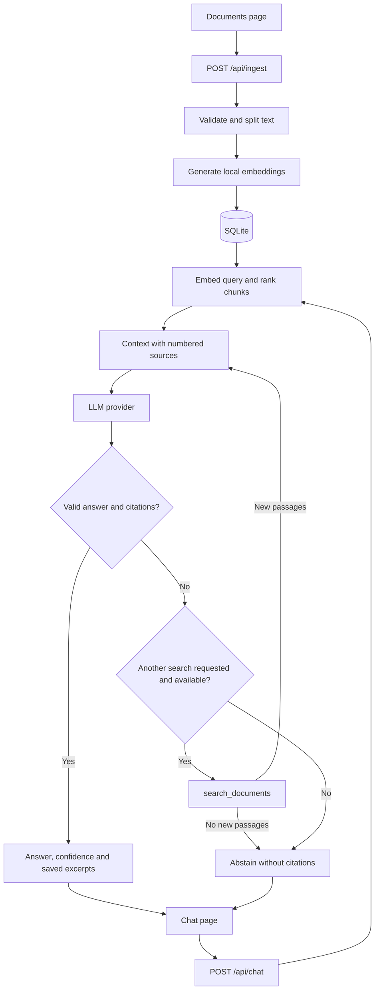

# Architecture

The browser holds the conversation and calls Next.js routes. The Node.js server owns the SQLite connection, embedding model and LLM adapter. Uploading a document prepares the index. Each question searches that index again.

## Writing the index

The ingestion route receives the file body and its name in the `x-filename` header. It checks the extension, declared media type, byte count during reading, UTF-8 encoding and text content. It sanitizes the filename and hashes the content with SHA-256 to detect duplicates. Chunks contain up to 80 units with a 16-unit overlap. A unit contains up to 64 consecutive non-whitespace characters. Slicing the original text preserves spacing for citations. [Upload validation](../src/lib/rag/upload.ts) · [Chunking](../src/lib/rag/chunking.ts)

Transformers.js runs quantized multilingual MiniLM on the CPU in batches of up to eight chunks. Mean pooling and normalization produce 384-dimensional vectors. A transaction writes the document name, text and hash to `documents`, and each chunk’s position, text and JSON vector to `chunks`. A foreign key cascades deletions. The persistent database is `data/rag.sqlite`. [Embeddings](../src/lib/rag/embeddings.ts) · [Schema](../src/lib/db.ts) · [Transaction](../src/lib/rag/vector-store.ts)

## Reading the index

1. The chat route validates the history and accepts questions up to 4,000 characters. The browser can send up to ten previous turns. For questions of six words or fewer, the search also includes the previous question to help resolve short references.
2. The server embeds the query and filters out chunks with cosine similarity below 0.35. Matching query terms can add up to 0.5 points to the remaining candidates, with greater weight for rare terms. Each search returns up to four chunks. [Retrieval](../src/lib/rag/retrieve.ts)
3. The model receives the question, history and a JSON payload with source IDs scoped to this answer. The system prompt treats filenames and excerpts as untrusted data and uses history only to interpret references. [Prompts](../src/lib/rag/prompts.ts)
4. The adapter validates structured output with Zod. The server requires answer text, at least one citation and IDs within the retrieved set. If the initial search finds no passages or the response lacks usable references, the model can request one reformulated search. A second generation requires new evidence. An empty library triggers an indexing prompt. A technical provider failure produces an error. [Answer flow](../src/lib/rag/answer.ts) · [Contracts](../src/lib/llm/contracts.ts)
5. The route delivers progress, validated text, citations and confidence as NDJSON events. Expanding a citation reveals the saved excerpt. The server checks that the referenced passage exists. Whether it supports every claim is a separate question for evaluation. [Chat route](../src/app/api/chat/route.ts) · [Chat interface](../src/components/chat.tsx)

The in-memory limiter allows ten requests per minute, with one shared quota during local development. Enable `TRUST_PROXY=true` only behind a proxy that overwrites `X-Real-IP` and is the server’s sole entry point. Provider calls respect client cancellation and a 180-second deadline.
